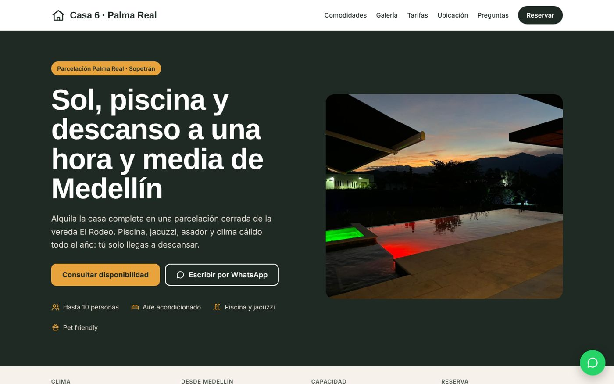
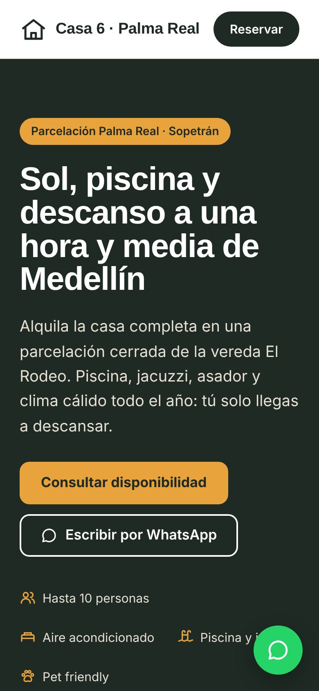
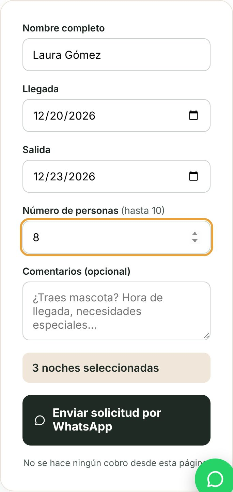
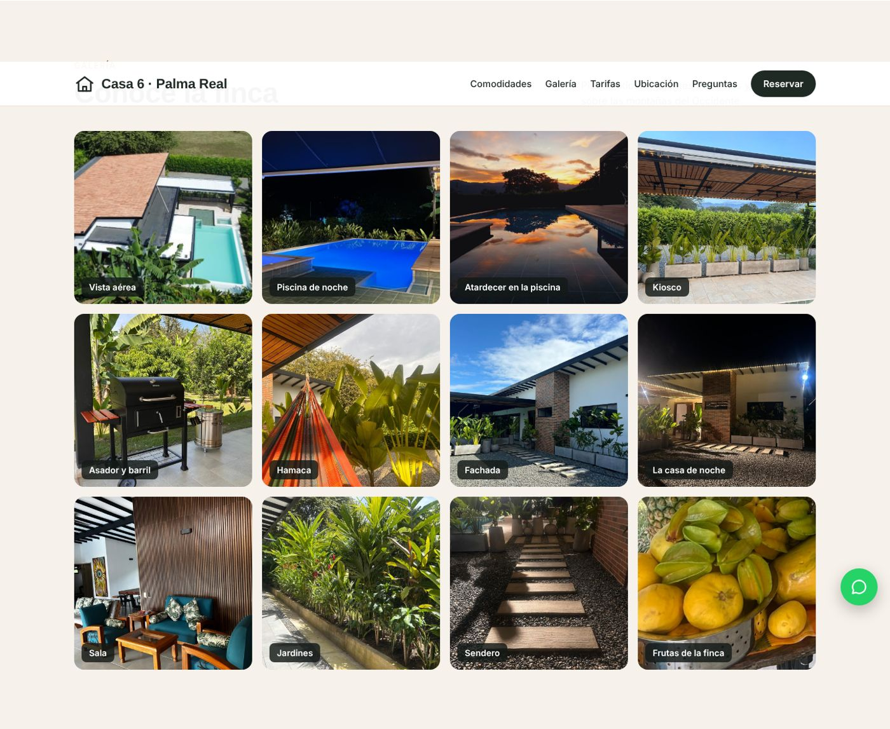

<div align="center">


# Casa 6 · Palma Real

**Landing page para el alquiler de una finca de descanso en Sopetrán, Antioquia (Colombia).**
Página estática, rápida y adaptable al celular, con reservas directas por WhatsApp.

[](https://sebxx66.github.io/FincaSope/)
[](https://github.com/Sebxx66/FincaSope/actions)




</div>

---

## Contenido

- [Sobre el proyecto](#sobre-el-proyecto)
- [Funcionalidades](#funcionalidades)
- [Capturas](#capturas)
- [Tecnologías](#tecnologías)
- [Estructura](#estructura)
- [Ejecutar en local](#ejecutar-en-local)
- [Despliegue](#despliegue)
- [Personalización](#personalización)
- [Autor](#autor)

## Sobre el proyecto

Sitio web promocional para **Casa 6**, una finca en la Parcelación Palma Real (vereda El Rodeo, Sopetrán) con capacidad para 10 huéspedes. El objetivo es que el visitante conozca la casa, vea fotos y video reales, consulte el precio de referencia y envíe su solicitud de reserva en pocos segundos, sin intermediarios ni comisiones de plataformas.

## Funcionalidades

| | |
|---|---|
| **Reserva por WhatsApp** | Formulario que arma el mensaje con nombre, fechas, noches calculadas y número de huéspedes, y abre el chat listo para enviar. |
| **Botón flotante** | Acceso directo a WhatsApp desde cualquier parte de la página. |
| **Galería y video** | 12 fotos reales y un recorrido en video vertical optimizado para carga rápida. |
| **Responsive** | Diseño fluido pensado primero para celular. |
| **Privada para buscadores** | Marcada con `noindex`: no aparece en Google ni en otros buscadores; solo la ve quien recibe el link. |
| **Vista previa al compartir** | Etiquetas Open Graph: al enviar el link por WhatsApp o redes aparece la foto de la piscina con el título. |
| **Accesibilidad** | HTML semántico, textos alternativos en todas las imágenes, etiquetas en formularios y contraste AA. |
| **Sin dependencias** | Un solo `index.html` con CSS y JavaScript nativos: nada que instalar ni compilar. |

## Capturas

<table>
  <tr>
    <td align="center"><br><sub>Celular</sub></td>
    <td align="center"><br><sub>Formulario de reserva</sub></td>
  </tr>
</table>

<p align="center"><br><sub>Galería</sub></p>

## Tecnologías

- **HTML5** semántico
- **CSS3** (Flexbox, Grid, `clamp()` para tipografía fluida)
- **JavaScript** nativo (sin frameworks)
- **Google Fonts:** Bricolage Grotesque e Inter
- **GitHub Actions + GitHub Pages** para el despliegue automático

## Estructura

```
FincaSope/
├── index.html              # Página completa (estructura, estilos y lógica del formulario)
├── img/                    # Fotos optimizadas (JPG ≤ 1600 px) + imagen Open Graph
├── video/recorrido.mp4     # Recorrido en video (H.264, 540 px)
├── favicon.svg             # Íconos del sitio
├── favicon-32.png
├── apple-touch-icon.png
├── robots.txt
├── docs/screenshots/       # Capturas para este README
└── .github/workflows/      # Despliegue automático a GitHub Pages
```

## Ejecutar en local

No necesita instalación. Clona el repositorio y abre `index.html` en el navegador, o levanta un servidor local:

```bash
git clone https://github.com/Sebxx66/FincaSope.git
cd FincaSope
python3 -m http.server 8000
# abre http://localhost:8000
```

## Despliegue

Cada `push` a `main` publica el sitio automáticamente en GitHub Pages mediante el workflow [`pages.yml`](.github/workflows/pages.yml).

Para activarlo la primera vez: **Settings → Pages → Build and deployment → Source: GitHub Actions**.

> Si el sitio se mueve a un dominio propio, reemplaza `https://sebxx66.github.io/FincaSope` en `index.html`.
>
> Para que vuelva a aparecer en Google, borra las etiquetas `<meta name="robots">` y `<meta name="googlebot">` de `index.html`.

## Personalización

| Qué cambiar | Dónde |
|---|---|
| Número de WhatsApp | `index.html` → busca `573146314972` |
| Precio de referencia | `index.html` → busca `1.300.000` |
| Fotos | Reemplaza el archivo en `img/` conservando el mismo nombre |
| Colores | `index.html` → `#1F2A24` (principal), `#E8A33D` (acento), `#F6F1EA` (fondo) |

## Autor

**Jhoan Sebastián Palacio Zapata** · Desarrollador de software

[](https://github.com/Sebxx66)
[](https://www.linkedin.com/in/jhoan-palacio-dev)

---

<sub>© 2026 Casa 6 · Palma Real. Fotografías, video y marca pertenecen al propietario de la finca; el código fue desarrollado por Jhoan Sebastián Palacio Zapata. Todos los derechos reservados.</sub>
